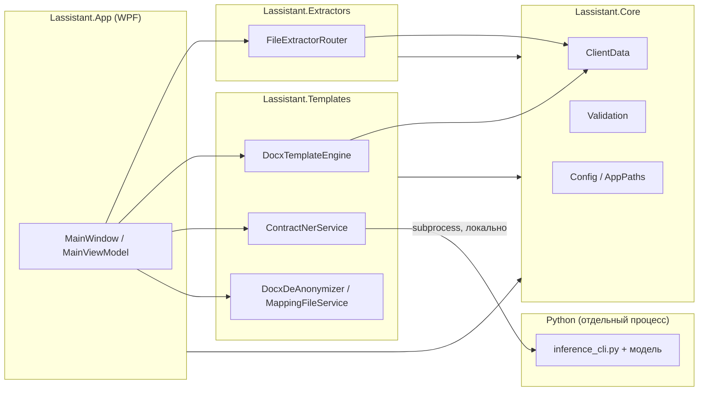
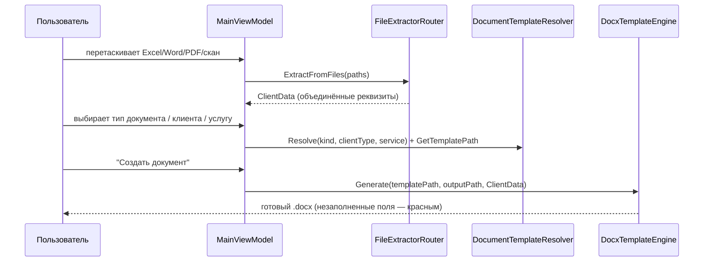
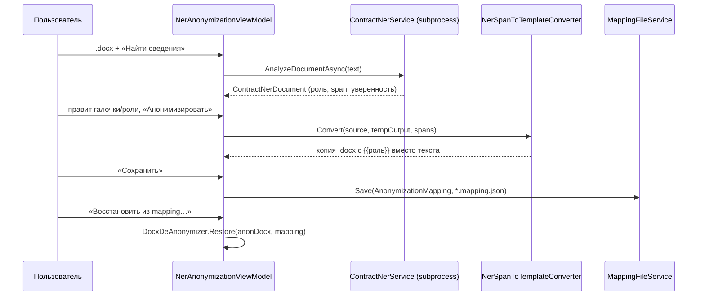

# Архитектура — Lassistant (Помощник юриста)

Версия документа соответствует приложению **1.6.6.2**. Обновляйте этот файл в том же коммите, где меняется структура проектов, потоки данных или публичные контракты между слоями.

## 1. Обзор архитектуры

Lassistant — однопользовательское **Windows-приложение (WPF, .NET 8)**, которое работает полностью локально, без сети и внешних API. Это осознанное ограничение продукта: обработка договоров и персональных данных должна соответствовать 152-ФЗ и не покидать контур пользователя.

Стиль — **слоистый монолит из четырёх .NET-библиотек плюс один внешний процесс**:

- `Lassistant.App` — WPF, экран и ViewModel'ы (MVVM без DI-контейнера — все ViewModel создаются напрямую в конструкторе `MainViewModel`, это осознанно простое связывание для приложения с одним окном).
- `Lassistant.Core` — конфигурация, пути, доменные модели, валидация. Не зависит ни от чего внутри решения.
- `Lassistant.Extractors` — импорт данных из внешних файлов (Excel, Word-карточка, PDF, скан) в единую модель `ClientData`.
- `Lassistant.Templates` — генерация DOCX по шаблонам, интеграция с Contract NER, анонимизация и обратная подстановка.
- **Contract NER** (`scripts/contract_ner/*.py`) — не .NET-компонент. Отдельный процесс Python в изолированном `python-venv-contract-ner/`, вызывается через `Process.Start` из `Lassistant.Templates.ContractNerService`. Никакая сеть не используется — inference идёт на той же машине.

Микросервисов и очередей в проекте нет — это desktop-инструмент для одного юриста, распределённая архитектура добавила бы сложность без выгоды.



## 2. Структура проекта

```
Lassistant.sln
src/
  Lassistant.App/              WPF UI — единственная точка входа (AssemblyName: Lassistant)
    MainWindow.xaml(.cs)         три вкладки: Создать документ / Анонимизация / Шаблоны
    AboutWindow.xaml(.cs)        окно «О программе», версия, ссылки на docs/руководства
    SettingsWindow.xaml(.cs)     выбор модели NER, порогов уверенности, путей user/
    ViewModels/                  MainViewModel + по одному VM на вкладку/сущность
    Controls/, Converters/       переиспользуемые WPF-элементы
  Lassistant.Core/              общий слой, не зависит от других src-проектов
    Config/                      загрузка JSON из config/ (каталог документов, поля, исполнители)
    Models/                      ClientData и маппинг в плейсхолдеры
    Services/                    AppPaths, CustomerCardStore, UserSettingsStore, UserDataBootstrap
    Validation/                  ИНН/КПП/ОГРН/СНИЛС/паспорт и общая схема валидации
  Lassistant.Extractors/        импорт данных из файлов в ClientData
    FileExtractorRouter.cs        выбирает экстрактор по расширению файла
    ExcelExtractor / WordCardExtractor / PdfExtractor / PassportOcrExtractor
  Lassistant.Templates/         генерация документов + весь NER-конвейер
    DocxTemplateEngine.cs         заливка {{плейсхолдеров}} в шаблон → готовый договор
    ContractNerService.cs         запуск Python-инференса, парсинг JSON-ответа
    NerEntityAggregator.cs, NerSpanToTemplateConverter.cs   span → {{роль}}
    ColoredDocxReader.cs, ColoredDocxToTemplateConverter.cs  разметка цветом → канонический шаблон
    AnonymizationMapping.cs, MappingFileService.cs, DocxDeAnonymizer.cs   анонимизация/восстановление
  Lassistant.SmokeTest/         консольный прогон Core+Extractors+Templates без WPF (не входит в .sln)
config/                        JSON-конфигурация (см. §6)
templates/                     DOCX-шаблоны поставки с {{плейсхолдерами}}
models/contract-ner/           веса NER-модели: ner_model_1.0 (откат), ner_model_1.1 (текущая)
scripts/
  contract_ner/                 inference_cli.py, postprocess.py, requirements*.txt
  publish.bat                   сборка self-contained win-x64 + копирование docs/config/templates
  generate_user_manual.py       сборка Руководство_пользователя.pdf
  md_to_html.py                 docs/руководства/*.md → *.html
docs/                          CHANGELOG, RELEASE_*, руководства, схемы ролей NER
user/                          создаётся при первом запуске (UserDataBootstrap), не в git:
                                  settings/ — user-settings.json, executors.json, ner-user-roles.json
                                  data/заказчики/ — карточки .md
release/, publish/             артефакты сборки — не в git
```

Полный список игнорируемого — [.gitignore](.gitignore): `bin/`, `obj/`, `publish/`, `release/`, `python-venv-contract-ner/`, `user/`, `tz/`.

## 3. Ключевые компоненты

| Компонент | Зона ответственности | Стек | Среда выполнения |
|---|---|---|---|
| `Lassistant.App` | Экран, MVVM, обработка ввода, вызов сервисов из Core/Extractors/Templates | WPF, .NET 8, `net8.0-windows10.0.17763.0` | процесс `Lassistant.exe`, UI-поток + `Dispatcher` для длительных операций |
| `Lassistant.Core` | Конфиги, пути (`AppPaths`), модель `ClientData`, валидация реквизитов | .NET 8 (без Windows-зависимостей) | тот же процесс, синхронно |
| `Lassistant.Extractors` | Импорт Excel/Word/PDF/скан в `ClientData` | ClosedXML, `DocumentFormat.OpenXml`, PdfPig, `Windows.Media.Ocr` | тот же процесс; OCR — фоновая STA-задача (`StaThreadRunner`) |
| `Lassistant.Templates` | Генерация DOCX, интеграция NER, анонимизация/восстановление | `DocumentFormat.OpenXml` | тот же процесс; вызов Python — дочерний процесс |
| Contract NER (`scripts/contract_ner/`) | Извлечение ролевых атрибутов из текста договора | Python 3.11/3.12, `rubert-tiny2` → `BertForTokenClassification`, изолированный venv | отдельный процесс, `stdin/stdout` JSON, без сети |
| `Lassistant.SmokeTest` | Ручная проверка Core+Extractors+Templates без запуска UI | .NET 8 консоль | отдельный exe, не входит в `Lassistant.sln` |

## 4. Потоки данных

### 4.1 Создание документа по шаблону



Каталог соответствий «тип документа × клиент × услуга → шаблон» — [config/document-catalog.json](config/document-catalog.json), поля и обязательность — [config/field-definitions.json](config/field-definitions.json). Форма на экране собирается по плейсхолдерам самого DOCX-шаблона (`TemplatePlaceholderScanner`), а не жёстко прошита в коде — если шаблон меняется, форма меняется вместе с ним без правки C#.

### 4.2 Анонимизация (вкладка «Анонимизация», NER-конвейер)



Формат плейсхолдеров анонимизации — тот же `{{роль}}`, что и в шаблонах генерации: одна нотация на весь проект. Файл `*.mapping.json` — единственное место, где хранится связь «плейсхолдер → исходные ПДн»; без него анонимизированный документ восстановить нельзя.

### 4.3 Вкладка «Шаблоны» — построение канонического шаблона из готового договора

Отдельный путь через `ColoredDocxReader` → `ColoredDocxToTemplateConverter` → `HighlightPlaceholderMapper`: юрист вручную выделяет цветом фрагменты в Word (бирюзовый, жёлтый, зелёный — цвета заданы в коде). Ключ `{{плейсхолдера}}` подбирается по тексту перед выделением из [config/label-prefix-map.json](config/label-prefix-map.json).

## 5. Важные архитектурные решения (ADR)

**Локальный inference вместо облачного API.**
NER-модель — `rubert-tiny2`, дообученная на ролевых атрибутах договоров, запускается субпроцессом на машине пользователя. Причина — 152-ФЗ и требование заказчика не передавать ПДн во внешние сервисы; это ограничение, а не техническое удобство, и его нельзя ослаблять точечными интеграциями.

**Сторона в таблице реквизитов определяется колонкой, а не моделью (с 1.6.6).**
Модель получает один абзац ячейки и не видит заголовка колонки, поэтому путала Исполнителя и Заказчика, когда набор реквизитов у сторон одинаковый. `DocxPlainTextExtractor.ExtractForNer` передаёт номер таблицы и колонки отдельно от текста. В `scripts/contract_ner/inference.py` `_table_party_map` определяет сторону колонки по заголовку («ИСПОЛНИТЕЛЬ», «ЗАКАЗЧИК:»); если заголовков нет и сторона выбрана по запасному правилу «колонка 0 — исполнитель, колонка 1 — заказчик», она модель не перебивает. `align_role_party` до постобработки заменяет префикс роли модели на сторону колонки, но только если такая роль есть в `id2label` модели (данные лицензии бывают только у исполнителя). Текст, который получает модель, не менялся, поэтому паритет с обучением сохраняется. Проверка без весов: `python inference.py --self-check`.

**Сторона по ячейке таблицы и по абзацу текста (с 1.6.6.2).**
`_table_party_map` строит сторону по ячейке (таблица, строка, колонка), а не по колонке: строка на всю ширину (фрагменты только колонки 0 при нескольких колонках) с заголовком «Заказчики» / «ИСПОЛНИТЕЛЬ:» задаёт сторону всех ячеек ниже до следующей такой строки — так размечаются договоры с несколькими заказчиками; иначе — заголовок колонки; иначе — запасное правило 0/1 без права перебить модель. Вложенная таблица без своего заголовка берёт сторону ячейки родителя (путь `P/r:c:n`). Вне таблиц части преамбулы получают сторону по своим словам «именуемое в дальнейшем «…»», представление стороны действует только на свой абзац (раньше сторона из преамбулы тянулась на весь договор), отдельные заголовки «ЗАКАЗЧИК» остаются «липкими». В строке подписей под «Исполнитель   Заказчик» сторона назначается находке по её месту, абзац при этом идёт в модель целиком: обрезанный «____Фамилия И.О.» модель режет на части. Вне таблиц подсказка стороны модель не перебивает.

**Python как подпроцесс, а не встроенный рантайм.**
`ContractNerService` вызывает `python.exe` из `python-venv-contract-ner/` через `Process.Start`, обмен — JSON по `stdin/stdout`. Так NER-стек (torch, transformers) остаётся изолированным от .NET-рантайма и обновляется независимо от `Lassistant.exe`.

**Форма создания документа строится по плейсхолдерам шаблона, а не по коду.**
`TemplatePlaceholderScanner` сканирует `{{ключи}}` прямо в `.docx`. Если поле нужно добавить в договор, достаточно поправить шаблон в Word — без пересборки приложения. Издержка: опечатка в плейсхолдере тихо создаёт лишнее поле в форме, а не ошибку сборки.

**`config/` — эталон только для чтения, `user/` — единственное место для правок пользователя.**
Роли, исполнители и карточки заказчиков пишутся оверлеем в `user/settings/*` и `user/data/заказчики/`, а `config/*.json` из UI никогда не перезаписывается. `publish.bat` не копирует `user/`, поэтому обновление версии не затирает личные данные (см. [docs/CHANGELOG.md — 1.6.2](docs/CHANGELOG.md)).

**MVVM без DI-контейнера.**
Все ViewModel создаются напрямую в конструкторе `MainViewModel`. Для приложения с одним окном и без модульной загрузки контейнер добавил бы косвенность без выгоды; если число вкладок вырастет на порядок, это решение стоит пересмотреть.

**Единая нотация плейсхолдеров `{{роль}}` для генерации и анонимизации.**
До 1.6.3 в проекте существовала вторая, regex-based анонимизация с нотацией `[КАТЕГОРИЯ_n]`, не совместимой с шаблонным движком. Она удалена; теперь генерация документов, анонимизация и восстановление используют одну и ту же модель span → `{{роль}}`, что убрало дублирование кода и вторую систему конфигурации (см. [RELEASE v1.6.3](docs/realese_history/RELEASE_v1.6.3.md)).

**Облачный разбор шаблонов убран в 1.6.4.**
Запасной путь через OpenAI-совместимый API и Anthropic удалён вместе с `LlmPlaceholderService`, подготовкой текста `[FIELD:]` и `config/llm-settings.json`. Вкладки «Шаблоны» и «Анонимизация» вызывают только локальный `ContractNerService`. Кнопка в интерфейсе — «Найти сведения». Пороги «минимальная уверенность» и «автопринятие по уверенности» — один список `NerScoreThresholdOption.All` (включая 0,90). С 1.6.5 двойной щелчок по колонке «Контекст» открывает `ContextPreviewWindow`: полный текст, по которому считались смещения NER, найденный фрагмент подсвечен. Короткий контекст в таблице остаётся обрезкой вокруг span. С 1.6.5.2 исправленный текст может захватывать соседний абзац: перевод строки в договоре совпадает с пробелом в ячейке, в Word первая строка становится `{{роль}}`, продолжение очищается.

**Чтение шаблона допускает совместный доступ (`FileShare.ReadWrite`).**
Ранний `TemplatePlaceholderScanner` открывал `.docx` в монопольном режиме и падал, если файл в этот момент был открыт в Word. Сканирование — только на чтение, поэтому конфликтов данных при совместном доступе нет, а падение формы хуже, чем гонка с редким параллельным редактированием.

## 6. Ограничения и правила

- **Никаких сетевых вызовов.** Ни `Lassistant.App`, ни `scripts/contract_ner` не должны обращаться в интернет. Облачный разбор договоров из приложения убран в 1.6.4.
- **Все пути — только через `AppPaths`.** Не собирать пути к `config/`, `templates/`, `user/` строками в других проектах — это единственное место, которое знает раскладку рядом с `exe`.
- **`config/*.json` не перезаписывается программой.** Пользовательские правки идут в `user/settings/*` (оверлей), чтение — всегда merge конфига и оверлея в `UserSettingsStore`/`PlaceholderRolesStore`.
- **Восстановление из анонимизации — только через `*.mapping.json`.** Не хранить original↔placeholder где-либо ещё (логи, temp-файлы за пределами `Path.GetTempPath()` с предсказуемым именем допустимы только на время сессии).
- **`Lassistant.Core` не должен зависеть от `Lassistant.App`, `Extractors` или `Templates`.** Это базовый слой; нарушение направления зависимостей — повод остановиться и пересмотреть, где на самом деле место новому коду.
- **Долгие операции (OCR, NER, извлечение из нескольких файлов) — через `Task.Run`/`async`, не блокируя UI-поток.** См. `ImportFilesAsync`, `AnalyzeWithContractNerAsync`.
- **`Lassistant.Anonymization` как отдельный проект не существует с 1.6.3.** Если нужна логика анонимизации — она в `Lassistant.Templates` (см. ADR выше); не создавать заново отдельную сборку под этот функционал без явной причины расти обратно в две системы.

## 7. Внешние интеграции

Явных внешних интеграций (облачных API, БД, очередей) в проекте нет — это ключевое архитектурное свойство продукта. Все «внешние» зависимости — локальные библиотеки и рантаймы на машине пользователя:

| Интеграция | Назначение | Где |
|---|---|---|
| `DocumentFormat.OpenXml` (NuGet) | Чтение/запись `.docx` (шаблоны, анонимизация) | `Lassistant.Extractors`, `Lassistant.Templates` |
| `ClosedXML` (NuGet) | Чтение `.xlsx` с реквизитами клиента | `Lassistant.Extractors.ExcelExtractor` |
| `PdfPig` (NuGet) | Извлечение текста из PDF | `Lassistant.Extractors.PdfExtractor` |
| `Windows.Media.Ocr` / `Windows.Data.Pdf` (WinRT) | Распознавание паспорта со скана/фото | `Lassistant.Extractors.PassportOcrExtractor` |
| Python 3.11/3.12 + `rubert-tiny2` (локальный venv) | Инференс NER-модели, подпроцесс | `scripts/contract_ner/`, вызывается из `ContractNerService` |

## Связанные документы

- [README.md](README.md) — установка, сборка, быстрый обзор возможностей
- [docs/CHANGELOG.md](docs/CHANGELOG.md) — история версий
- [docs/realese_history/](docs/realese_history/) — описания релизов
- [docs/ROLE_SCHEMA_v1.1.1.md](docs/ROLE_SCHEMA_v1.1.1.md), [docs/NER_ROLES_AND_KEYS.md](docs/NER_ROLES_AND_KEYS.md) — канон ролей NER
- [docs/LOCAL_CONTRACT_NER.md](docs/LOCAL_CONTRACT_NER.md) — установка и запуск NER-модуля
