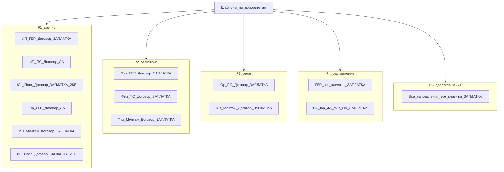

# Чеклист шаблонов по приоритетам

**Дата сверки:** 19.08.2026 (пересверка по размеру файла)  
**Источник приоритетов:** [`tz/приоритеты_шаблонов/prioritety_shablonov_tablitsa.xlsx`](../tz/приоритеты_шаблонов/prioritety_shablonov_tablitsa.xlsx)  
**Сверка:** [`config/document-catalog.json`](../config/document-catalog.json) + файл в [`templates/`](../templates/) + **размер файла**  
**Цветная схема:** canvas `template-priority-checklist.canvas.tsx` (открыть рядом с чатом) · [HTML](template-priority-checklist.html)

### Легенда статуса

| Статус | Значение |
|--------|----------|
| **ДА** | `isStub: false`, файл из `templateFile` есть в `templates/`, и размер **существенно больше ~2 КБ** (реальный DOCX, обычно ≥18 КБ) |
| **ЗАПЛАТКА** | файл ≈ **1.5–2 КБ** (пустой/минимальный DOCX), или `isStub: true`, или копия с другого типа клиента, или в каталоге имя `demo_*`, которого **нет** в `templates/` |
| **НЕТ** | нет записи в каталоге под эту комбинацию |

Порог: в `templates/` **27** файлов ≈1.5–1.7 КБ = заплатки; **полноценных** только: ИП/ПС (~38 КБ), юрлицо/ГБР (~49 КБ + муниципалитет ~43 КБ), расторжение юрлицо/ПС (~18 КБ).

Цвета приоритетов: **P1** высокий, **P2** регулярно, **P3** реже, **P4** расторжение, **P5** допсоглашения.  
Статус: зелёный = ДА, янтарный = ЗАПЛАТКА, красный = НЕТ / разрыв.

---

## Чеклист (колонка «Есть в наличии / не заплатка»)

### Приоритет 1 (срочно)

| # | Направление | Клиент | Документ | Статус | Факт |
|---|-------------|--------|----------|--------|------|
| 1 | ГБР | ИП | Договор | **ЗАПЛАТКА** | Каталог → `договор_ип_гбр.docx` (нет в `templates/`). Короткий `договор_ип_гбр.docx` ≈1.6 КБ |
| 2 | Пожарная | ИП | Договор | **ДА** | `Договор_ИП_пожарная_сигнализация.docx` ≈38 КБ, `isStub: false` |
| 3 | Пост охраны | Юрлицо | Договор | **ЗАПЛАТКА** | `договор_юрлицо_пост_охраны.docx` ≈**1.6 КБ** (несмотря на `isStub: false`) |
| 4 | ГБР | Юрлицо | Договор | **ДА** | `договор_юрлицо_гбр.docx` ≈49 КБ, `isStub: false` |
| 5 | Монтаж | ИП | Договор | **ЗАПЛАТКА** | Каталог → `demo_*` нет; короткий `договор_ип_монтаж.docx` ≈1.6 КБ |

Дополнительно (нет в xlsx, продукт 1.5.4.5): **Пост охраны / ИП / Договор** → **ЗАПЛАТКА** (`договор_ип_пост_охраны.docx` ≈1.6 КБ, копия юрлица).

### Приоритет 2 (регулярно)

| # | Направление | Клиент | Документ | Статус | Факт |
|---|-------------|--------|----------|--------|------|
| 6 | ГБР | Физлицо | Договор | **ЗАПЛАТКА** | Каталог → `demo_*` нет; короткий `договор_физлицо_гбр.docx` ≈1.5 КБ |
| 7 | Пожарная | Физлицо | Договор | **ЗАПЛАТКА** | То же; `договор_физлицо_пс.docx` ≈1.6 КБ |
| 8 | Монтаж | Физлицо | Договор | **ЗАПЛАТКА** | То же; `договор_физлицо_монтаж.docx` ≈1.5 КБ |

### Приоритет 3 (реже)

| # | Направление | Клиент | Документ | Статус | Факт |
|---|-------------|--------|----------|--------|------|
| 9 | Пожарная | Юрлицо | Договор | **ЗАПЛАТКА** | Каталог → `demo_*` нет; короткий `договор_юрлицо_пс.docx` ≈1.6 КБ |
| 10 | Монтаж | Юрлицо | Договор | **ЗАПЛАТКА** | Аналогично; `договор_юрлицо_монтаж.docx` ≈1.6 КБ |

### Приоритет 4 (расторжение)

| # | Направление | Клиент | Документ | Статус | Факт |
|---|-------------|--------|----------|--------|------|
| 11 | ГБР | Все | Расторжение | **ЗАПЛАТКА** | Физ/ИП/юрлицо: файлы ≈1.6–1.7 КБ, `isStub: true` |
| 12 | Пожарная | Все | Расторжение | **смесь** | Юрлицо ПС: ≈18 КБ → **ДА**; физ/ИП ≈1.6 КБ → **ЗАПЛАТКА** |

Расторжение / пост охраны / юрлицо: ≈1.7 КБ, `isStub: true` → **ЗАПЛАТКА**.

### Приоритет 5 (допсоглашения)

| # | Направление | Клиент | Документ | Статус | Факт |
|---|-------------|--------|----------|--------|------|
| 13 | Все | Все | Допсоглашение | **ЗАПЛАТКА** | Все addendum ≈1.6–1.7 КБ, `isStub: true` |

---

## Сводка

- **ДА (полноценный DOCX):** ИП/ПС; юрлицо/ГБР; юрлицо/расторжение ПС.
- **ЗАПЛАТКА / разрыв:** пост охраны (юр и ИП, ≈1.6 КБ); договоры с `demo_*` без файла; все короткие ~2 КБ; все допсоглашения; почти все расторжения.
- **Главный техдолг для P1:** заменить ~2 КБ заглушки реальным контентом (особенно пост охраны) и починить `templateFile` на `договор_{клиент}_{услуга}.docx` там, где каталог ссылается на отсутствующий `demo_*`.

---

## Дерево (приоритет → статус)

---

*Инвентаризация готовности; контент Word-шаблонов этим документом не правится.*
