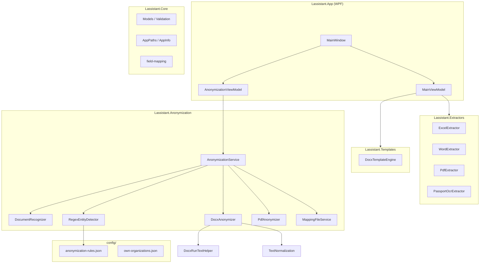
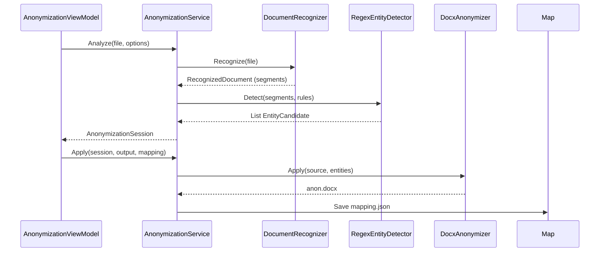

# Архитектура Lassistant 1.1

Версия документа: **1.1.0** · 17.06.2026

---

## 1. Обзор

Lassistant — десктопное WPF-приложение (.NET 8, Windows x64) с модульной архитектурой. Версия 1.1 добавляет слой **анонимизации** без изменения контрактов модуля создания документов.



---

## 2. Проекты solution

| Проект | Назначение | Зависимости |
|--------|------------|-------------|
| **Lassistant.App** | WPF UI, ViewModels | Core, Extractors, Templates, Anonymization |
| **Lassistant.Core** | Модели, валидаторы ИНН/ОГРН/СНИЛС, пути | — |
| **Lassistant.Extractors** | Импорт Excel/Word/PDF/OCR | Core |
| **Lassistant.Templates** | Заполнение `{{placeholders}}` в docx | Core, OpenXML |
| **Lassistant.Anonymization** | Поиск и замена ПДн | Core, OpenXML, PdfPig |
| **Lassistant.SmokeTest** | Отладочные утилиты | Extractors |
| **scripts/AnonDetectCli** | CLI-тест детектора (отладка) | Anonymization |

Версия всех сборок: `1.1.0` (`src/Directory.Build.props`).

---

## 3. Поток «Создать документ» (v1.0)

```
Файлы → Extractors → ClientForm (поля) → DocxTemplateEngine → .docx
```

1. Пользователь загружает источники
2. `MainViewModel` вызывает экстракторы по типу файла
3. Поля маппятся через `field-mapping.json`
4. `DocxTemplateEngine` подставляет `{{FieldName}}` в шаблон из `templates/`

---

## 4. Поток «Анонимизация» (v1.1)



### 4.1. Распознавание (`DocumentRecognizer`)

- **DOCX:** параграфы body + headers + footers → `TextSegment` с id `document_pN`
- **PDF:** текстовый слой постранично; при отсутствии — OCR через `PassportOcrExtractor`

### 4.2. Детекция (`RegexEntityDetector`)

- Загрузка `anonymization-rules.json` → категории с regex-паттернами
- Для каждого сегмента: `CollectMatches` → `ResolveOverlaps`
- **Приоритет:** `High` (enum 0) перед `Low` (enum 1), затем длина span
- Валидаторы: `inn`, `ogrn`, `snils` → повышение/понижение уверенности
- `PlaceholderEngine` — единый плейсхолдер для одинаковых значений в документе
- `NormalizeMatch` — trim, обрезка на `[`, пунктуация

### 4.3. Замена DOCX (`DocxAnonymizer`)

Двухфазная замена в каждом параграфе:

1. **Глобальная** — все вхождения каждого `Original → Placeholder` (сначала длинные строки)
2. **По сегментам** — точные offset из детектора

`DocxRunTextHelper` — замена span через несколько Word `w:t` runs.  
`TextNormalization` — сравнение с учётом NBSP и Unicode-маркеров.

### 4.4. Замена PDF (`PdfAnonymizer`)

- Текстовый PDF: поиск по координатам слов
- OCR-PDF: замена на уровне текста страницы (ограничение v1.1)

### 4.5. Mapping (`MappingFileService`)

JSON-файл:

```json
{
  "Version": "1.0",
  "AppVersion": "1.1.0",
  "Replacements": [
    { "Placeholder": "[ФИО_1]", "Original": "…", "Category": "PERSON", "Confidence": "low" }
  ]
}
```

`DocxDeAnonymizer` восстанавливает оригиналы по mapping.

---

## 5. Конфигурация

| Файл | Загрузчик | Назначение |
|------|-----------|------------|
| `anonymization-rules.json` | `AnonymizationRulesConfig` | Категории, regex, placeholder |
| `anonymization-policy.json` | Политика облака (задел) | |
| `own-organizations.json` | `OwnOrganizationsConfig` | Исключения юрлиц |
| `field-mapping.json` | `FieldMappingConfig` | Импорт полей |

Путь: `{exe_dir}/config/` (`AppPaths.ConfigDirectory`).

---

## 6. Модели данных (анонимизация)

| Тип | Описание |
|-----|----------|
| `RecognizedDocument` | Исходный файл + список `TextSegment` |
| `TextSegment` | Id, текст параграфа/страницы |
| `EntityCandidate` | Категория, value, start/end, placeholder, confidence |
| `AnonymizationSession` | Document + entities + options |
| `AnonymizationOptions` | SearchMode, EnabledCategories, ExcludeOwnOrganizations |
| `SearchMode` | Conservative, Aggressive, ManualOnly |

---

## 7. UI-слой

- **MVVM:** `MainViewModel`, `AnonymizationViewModel`, `EntityRowViewModel`
- Вкладки в `MainWindow.xaml` — без отдельных окон
- Режим поиска — `RadioButton` → `SearchMode` (обработчик читает `sender`, не поля до `InitializeComponent`)

---

## 8. Сборка и развёртывание

```
scripts/publish.bat
  → dotnet publish Lassistant.App (win-x64, single-file)
  → xcopy config/, templates/, docs/
  → publish/win-x64/Lassistant.exe
```

Self-contained: .NET runtime внутри exe, внешние только `config/` и `templates/`.

---

## 9. Расширяемость (roadmap)

| Точка расширения | v1.2+ |
|------------------|-------|
| `anonymization-providers.json` | PaddleOCR, облачный VLM |
| `IEntityDetector` | Альтернатива regex (LLM) |
| Пакетный pipeline | Папка → очередь файлов |
| UI редактор правил | Без правки JSON |

---

## 10. Тестирование и отладка

| Инструмент | Назначение |
|------------|------------|
| `scripts/AnonDetectCli` | Детекция + `--apply` на тестовом docx |
| `scripts/analyze_yellow.py` | Сверка жёлтой разметки Word с rules |
| `docs/otchet_*.md` | Отчёты по договорам КС 280, КГ |

---

## 11. Безопасность

- Нет сетевых вызовов в runtime
- Mapping = чувствительные данные, хранится локально
- Ответственность за передачу в облако — на пользователе (дисклеймер в ТЗ)
